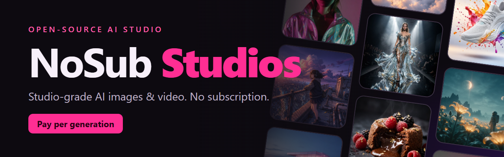
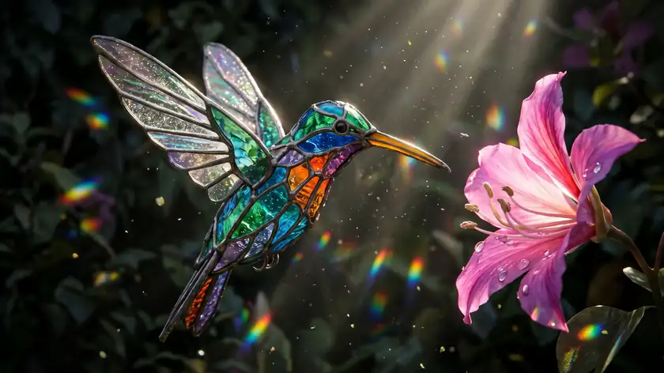
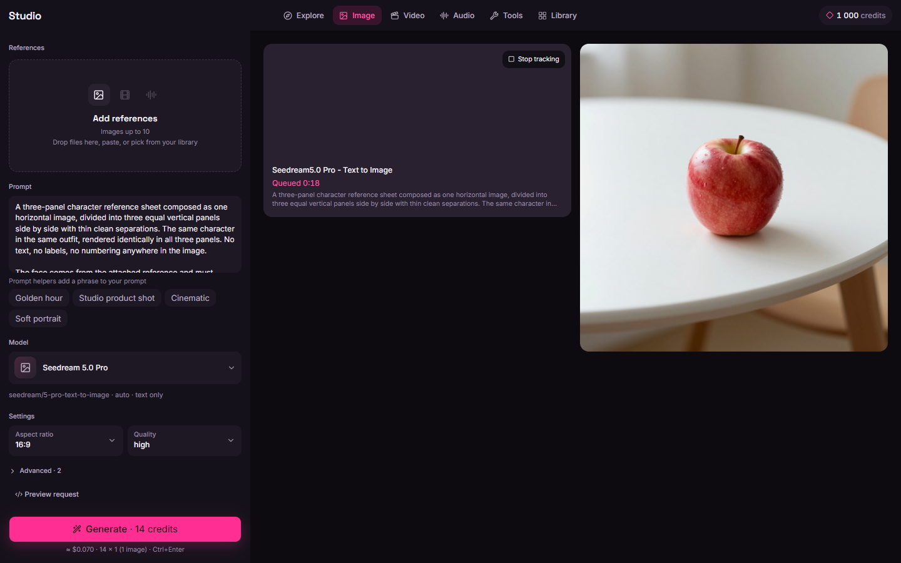
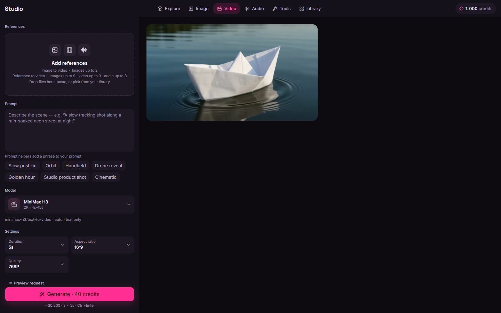
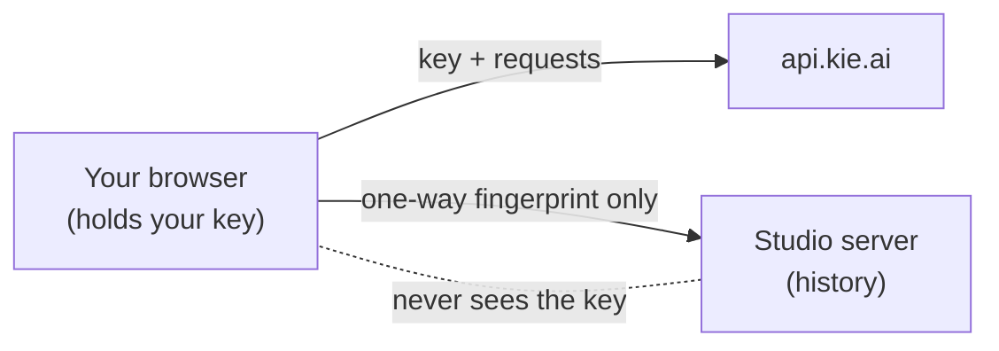
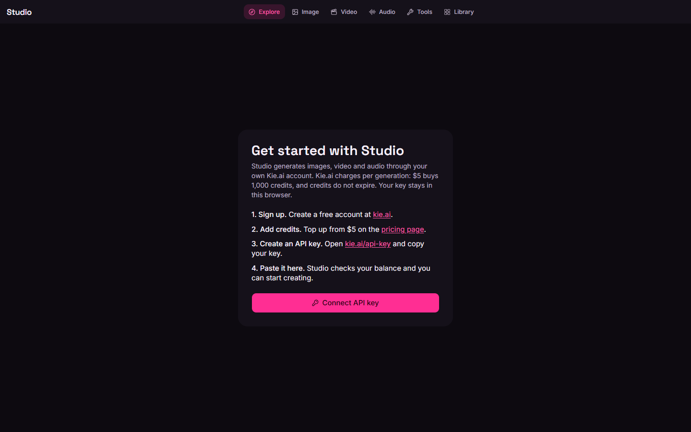

<p align="center">
  
</p>

<p align="center">
  
  
  
  
</p>

<p align="center">
  <b>Studio-grade AI images &amp; video. No subscription.</b><br>
  An open-source studio for images, video, audio and tools. Bring your own <a href="https://kie.ai">Kie.ai</a> key and pay only for what you generate.
</p>

<p align="center">
  <a href="#quick-start"><b>Open the cloud studio</b></a> <!-- TODO: cloud URL -->
  &nbsp;&nbsp;|&nbsp;&nbsp;
  <a href="#run-locally"><b>Run locally</b></a>
</p>

<p align="center">
  
</p>

## Why NoSub

- **Pay only per generation.** No monthly plan, no seats, no credits that vanish at month end. You pay Kie.ai for each image, clip or track you make.
- **Credits never expire.** On Kie.ai, $5 buys 1,000 credits and they stay in your account until you use them.
- **Every top model in one place.** Compare them by price before you run. At 2K, one image costs 6 credits with Nano Banana 2.1, 10 with GPT Image 2.5 and 14 with Seedream 5 Pro. A 5 second Wan 3.0 video at 720p is 80 credits (16 per second).

## One prompt, three models

Same prompt, three models. Pick the look you like and the price you want.

<table>
<tr>
<td align="center" width="33%"><br><b>GPT Image 2.5</b><br><sub>10 credits at 2K</sub></td>
<td align="center" width="33%"><br><b>Nano Banana 2.1</b><br><sub>6 credits at 2K</sub></td>
<td align="center" width="33%"><br><b>Seedream 5 Pro</b><br><sub>14 credits at 2K</sub></td>
</tr>
</table>

> A tiny ramen stall glowing on a rainy neon-lit street at night, steam rising from bowls, a cat sleeping on the counter, ...

## Made with NoSub Studios

<table>
<tr><td align="center" width="25%"><br><sub>Portrait · Seedream 5 Pro</sub></td><td align="center" width="25%"><br><sub>Product · GPT Image 2.5</sub></td><td align="center" width="25%"><br><sub>Fashion · Nano Banana 2.1</sub></td><td align="center" width="25%"><br><sub>Anime · Nano Banana 2.1</sub></td></tr>
<tr><td align="center" width="25%"><br><sub>Cinematic · Seedream 5 Pro</sub></td><td align="center" width="25%"><br><sub>Fantasy · GPT Image 2.5</sub></td><td align="center" width="25%"><br><sub>Food · Nano Banana 2.1</sub></td><td align="center" width="25%"><br><sub>Architecture · Seedream 5 Pro</sub></td></tr>
</table>

## Image to video

<table>
<tr>
<td align="center" width="50%"><br><sub>Still: Nano Banana 2.1</sub></td>
<td align="center" width="50%"><br><sub>Clip: Wan 3.0, 5 s, 80 credits</sub></td>
</tr>
</table>

Make a still with Nano Banana 2.1, use it as the first frame, and bring it to life with Wan 3.0.

## Everything in one studio

- **Image.** Text to image and image editing across the top models.
- **Video.** Text to video and image to video, with the price shown before you run.
- **Audio.** Music and audio generation.
- **Tools.** Upscale and other media tools.
- **Explore.** Browse every model with its settings and cost.
- **Library.** All your results in one place, with ZIP download.
- **Reference images.** Add references and call them inline with `@` chips inside the prompt.
- **Compare by price.** See what a run will cost, and compare models side by side before you spend credits.

<p align="center">
  
  
</p>

## Your key stays yours

In cloud mode your Kie.ai key stays in your browser. The browser talks to Kie.ai directly, and the Studio server never receives the key. It only sees a one-way fingerprint, used to find your history.



## Quick start

### Cloud

Open the cloud studio <!-- TODO: cloud URL -->, connect your Kie.ai key, and generate.

<p align="center">
  
</p>

### Run locally

```bash
pnpm install
pnpm dev
```

Open http://localhost:3000 and click **Connect API key**. Requirements: Node.js 24 or newer and pnpm.

## For developers

`pnpm build && pnpm start` runs the production build. Checks: `pnpm typecheck`, `pnpm lint`, `pnpm test`.

The scope is media only. There is no chat, no LLM models and no `/chat/completions` calls. The one exception
is `GET /api/v1/chat/credit`: despite its path, it is the credit balance endpoint.

### Environment

Copy `.env.example` to `.env.local`. All variables are optional.

| Variable | Purpose |
| --- | --- |
| `KIE_API_KEY` | Server-only key. It takes priority over a key saved in the UI, and the UI says when it is in use. |
| `KIE_API_BASE_URL` | Default `https://api.kie.ai` |
| `KIE_UPLOAD_BASE_URL` | Default `https://kieai.redpandaai.co` |
| `KIE_DATA_DIR` | Default `./data` (SQLite history and downloaded outputs) |
| `KIE_WEBHOOK_ENABLED`, `KIE_PUBLIC_URL`, `KIE_WEBHOOK_HMAC_KEY` | Optional webhooks behind a public tunnel (see below) |

In local mode, a key saved in the UI lives only in an HTTP-only cookie. It never goes to the browser, localStorage, logs or
server responses. All Kie.ai calls are made by the server.

### Cloud deploy

The same codebase can run as a hosted app, free of charge, on Turso and Vercel Hobby. In cloud mode the browser
calls Kie.ai directly with the visitor's own key, and the Studio server only stores history.

1. Create a free database at [Turso](https://turso.tech). Note its URL (`libsql://...`) and create an auth token.
2. Import this repository into [Vercel](https://vercel.com) (Hobby plan).
3. Set these environment variables in the Vercel project:

| Variable | Value |
| --- | --- |
| `NEXT_PUBLIC_STUDIO_MODE` | `cloud` |
| `TURSO_DATABASE_URL` | Your Turso database URL |
| `TURSO_AUTH_TOKEN` | Your Turso auth token |
| `CLOUD_OWNER_SECRET` | Random secret, at least 32 bytes. Used to hash key fingerprints before they are stored. |
| `CRON_SECRET` | Random secret, at least 32 bytes. Vercel sends it to the daily cleanup job (`vercel.json`). |

Generate each secret with `openssl rand -base64 32`. Do **not** set `KIE_API_KEY` in cloud mode: every visitor
connects their own key in the browser, and the server never holds one. Do not change `CLOUD_OWNER_SECRET` after
launch, because existing history would no longer match its owners.

In cloud mode history is kept for 90 days, with up to 2000 records per key, and the daily job deletes older
records. Kie.ai itself keeps generated files for 14 days.

### How your key is handled

- In cloud mode your Kie.ai key stays in your browser. If you choose to remember it, it is stored in IndexedDB,
  encrypted with AES-GCM under a non-extractable browser key. It is never put in localStorage or cookies.
- The browser sends the key only to `api.kie.ai` and `kieai.redpandaai.co`. The Studio server never receives it.
- The Studio server sees only a one-way fingerprint (an HMAC of the key, computed in the browser), which it
  hashes again with a server secret before storing. It is used to find your history, and the key cannot be
  recovered from it.
- The pages are served with a strict Content-Security-Policy: scripts only from the app itself (nonce-based, no
  inline scripts, no `eval`), `connect-src` limited to Studio and the Kie.ai hosts, and `frame-ancestors 'none'`.
  Further details and known limitations are in [docs/security-review-2026-10.md](docs/security-review-2026-10.md).
- Disconnecting wipes the stored key from the browser.

### How it works

- **Catalog.** `lib/catalog/generated/catalog.json` is generated from the OpenAPI blocks of the docs.kie.ai pages
  in `docs-cache/`. Never edit it by hand. `pnpm catalog:fetch` refreshes the docs and the pricing snapshot;
  `pnpm catalog:build` regenerates the catalog. A model whose docs have problems is shown as **unverified**,
  with the reason. Every model is also marked **not live-tested** until it is added to
  `lib/catalog/live-tested.ts`.
- **Adapters** (`lib/kie/adapters/`) share one interface (`submit`, `getStatus`, normalized `{state, outputs, error}`):
  - `market`: `POST /api/v1/jobs/createTask` and `GET /api/v1/jobs/recordInfo`. In the current docs this also
    covers Veo 3.1, Runway, Suno, 4o Image and Flux Kontext.
  - `omni-asset`: the synchronous, free Gemini Omni helpers (`/api/v1/omni/audio/create`, `/character/create`).
  - `suno-recovery`: polled through `/api/v1/suno/recovery/record-info`. This one is unverified (see the docs
    conflicts below).
- **Forms** are built from each model's JSON schema. Enums become selects, numbers with a documented range get
  sliders, booleans get switches, URL fields get upload dropzones (or a pasted URL), arrays of objects get
  repeaters, and schemas with variants (`oneOf`) get tabs. Inputs are validated with Zod in the browser and
  again on the server. Undocumented fields are rejected.
- **Cost guardrails.** Kie.ai has no cancel endpoint, so the estimate is shown before you submit. Runs estimated
  at 100 credits or more, and video runs with an unknown cost, must be confirmed. A submit is blocked when the
  balance is below the estimate. The estimate comes from the kie.ai/pricing snapshot, matched by model name and
  your settings, so treat it as approximate. The real charge (`creditsConsumed`) and the balance before and
  after are stored for every task.
- **No double charges.** Each submit carries an idempotency key, and the database row is written before the
  network call. `createTask` is never retried: a timeout or a dropped connection after sending sets the task to
  *Submit unknown* and points you to kie.ai/logs.
- **Polling.** The server sets the backoff: it starts at 4 s, multiplies by 1.5 each time, and caps at 30 s.
  Tracking times out after 15 min for images, 20 min for audio and tools, and 90 min for video. **Stop tracking**
  only stops polling, because generation continues on Kie.ai and is still charged. **Resume tracking** picks the
  task up again. Active tasks resume automatically when the app is opened again.
- **Outputs** are downloaded to `data/outputs/<taskId>/` as soon as a task succeeds, because Kie.ai deletes
  generated files after 14 days. If the direct download fails, the app falls back to
  `/api/v1/common/download-url`.
- **Uploads.** Files go from the browser to `/api/upload` and then to Kie.ai's File Stream Upload, right before
  submit. Kie.ai deletes uploads after 24 h, so they are never reused.

#### Webhooks (optional)

The app runs on localhost, so Kie.ai cannot reach it and polling is the main mechanism. If you expose the app
through a tunnel, set `KIE_WEBHOOK_ENABLED=1`, `KIE_PUBLIC_URL=https://<tunnel>` and `KIE_WEBHOOK_HMAC_KEY`
(from kie.ai/settings). Callbacks to `/api/webhook/kie` are checked as
`base64(HMAC-SHA256(taskId + "." + timestamp, key))` with a constant-time comparison and a ±5 min timestamp
window. A verified callback only triggers an immediate poll. The callback body is not trusted.

### Error handling

The UI shows each of these differently: missing key, invalid key (401), insufficient credits (402), rate limit
(429; Kie.ai allows 20 new generation requests per 10 s), validation (422 or a non-200 body `code`),
maintenance (455), provider `fail` (with `failCode` and `failMsg`), network errors while polling (polling
retries, nothing is resubmitted), and an ambiguous submit.

## License

TBD
